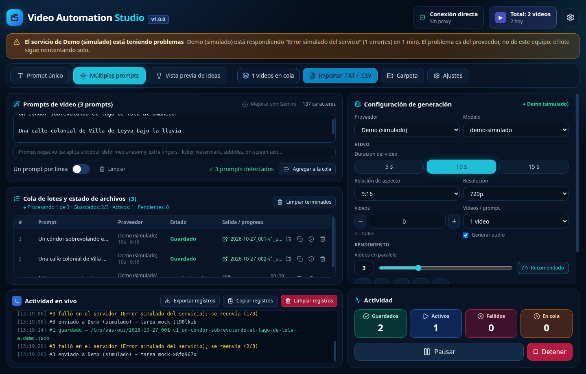

# Video Automation Studio

Aplicación de escritorio (Electron + React + TypeScript) para **generar videos con IA por lotes** con los modelos **Seedance** de ByteDance (y otros), usando únicamente **APIs oficiales con API key**:

| Proveedor | API | Modelos por defecto |
|---|---|---|
| **fal.ai** | Cola oficial `queue.fal.run` ([docs](https://fal.ai/models/bytedance/seedance-2.5/text-to-video/api)) | `bytedance/seedance-2.5/text-to-video`, `bytedance/seedance-2.0/fast/text-to-video`, `fal-ai/bytedance/seedance/v1.5/pro/text-to-video` |
| **BytePlus ModelArk** | `contents/generations/tasks` ([docs](https://docs.byteplus.com/en/docs/modelark/1366799)) | `dreamina-seedance-2-5-260628`, `seedance-1-0-pro-250528` |
| **Demo (simulado)** | Ninguna: simula la generación | Sirve para probar la cola sin gastar créditos |

> No usa cookies de sesión, varias cuentas ni automatización del navegador. Respeta los límites de uso de cada proveedor.



## Funciones

- **Tres modos**: prompt único, múltiples prompts (separados por línea en blanco o `---`, o uno por línea) y vista previa de ideas.
- **Importación de .TXT y .CSV** (columnas opcionales: `prompt, negative_prompt, duration, aspect_ratio`). Hay ejemplos en [`examples/`](examples).
- **Prompt negativo global** y **mejora de prompts con Gemini** (opcional, con tu propia API key).
- **Configuración de generación**: proveedor, modelo, duración (5/10/15 s), relación de aspecto, resolución, cantidad de videos (0 = todos), variantes por prompt y audio.
- **Videos en paralelo** (1–8) con un botón **Recomendado** calculado según tu límite de solicitudes por minuto.
- **Cola en vivo** con estados (En espera, Enviando, Renderizando, Descargando, Guardado, Error, Necesita revisión), barra de progreso, tiempo transcurrido y acciones por fila: reintentar, cancelar, duplicar, ver detalles, abrir el archivo o mostrarlo en la carpeta.
- **Reintentos automáticos** con backoff exponencial y jitter; respeta `Retry-After` en los errores 429. Si el servidor falla de forma repetida, aparece un **aviso naranja** que indica que el problema es del proveedor y que el lote sigue reintentando.
- **Recuperación tras cerrar la app**: las tareas ya enviadas se retoman consultando su estado; los videos guardados no se repiten.
- **Archivos de salida** con el formato `{fecha}_{índice}-v{variante}_{slug-del-prompt}.mp4`, junto a un `.json` con el prompt y los parámetros.
- **Estimación de costo** del lote, según el precio por segundo que configures.
- **Registro de actividad** en vivo con marcas de hora, que puedes copiar, exportar o limpiar.
- **Ajustes**: API keys cifradas con el llavero del sistema (Electron `safeStorage`: Keychain, DPAPI o libsecret), proxy HTTP opcional, carpeta de salida, reintentos, intervalo de consulta, límites por minuto, precios, lista de modelos e idioma (ES/EN).

## Requisitos

- Node.js 20 o superior
- Una API key de [fal.ai](https://fal.ai/dashboard/keys) o de [BytePlus ModelArk](https://console.byteplus.com/ark/region:ark+ap-southeast-1/apiKey). Para BytePlus también debes activar el modelo en la consola.
- Opcional: una API key de [Google AI Studio](https://aistudio.google.com/apikey) para mejorar prompts con Gemini.

## Instalación y uso

```bash
npm install
npm run dev        # abre la app en modo desarrollo (Vite + Electron)
```

1. Abre **Ajustes** (icono de engranaje), pega tu API key y pulsa **Probar conexión**.
2. Elige el proveedor y el modelo en **Configuración de generación**.
3. Escribe o importa tus prompts y pulsa **Iniciar generación por lotes**.

Para probar sin gastar créditos, elige el proveedor **Demo (simulado)**.

## Compilar instaladores

```bash
npm run dist:win   # instalador NSIS para Windows (.exe)
npm run dist:mac   # .dmg para macOS (debe ejecutarse en un Mac)
npm run dist       # para la plataforma actual
```

Los instaladores quedan en `release/`.

## Scripts

| Comando | Descripción |
|---|---|
| `npm run dev` | Desarrollo con recarga automática |
| `npm test` | Pruebas unitarias (Vitest): parser, CSV, backoff, limitador, motor de la cola y proveedores |
| `npm run build` | Revisión de tipos + compilación del renderer y del proceso principal |
| `npm start` | Ejecuta la versión compilada |

## Arquitectura

```
core/                  Lógica pura en TypeScript (sin dependencias de Electron; con pruebas)
  engine.ts            Motor de la cola: concurrencia, reintentos, consulta de estado, recuperación
  backoff.ts           Errores del proveedor, backoff exponencial, Retry-After y RateLimiter
  promptParser.ts      Separación de prompts, parser CSV y prompt negativo
  gemini.ts            Mejora de prompts con Gemini
  providers/           Interfaz VideoProvider + fal.ai, BytePlus y el proveedor simulado
electron/
  main.ts              Ventana, IPC, descargas (streaming), proxy (undici) y persistencia
  preload.ts           Puente seguro (contextIsolation) hacia window.studio
  secrets.ts           API keys cifradas con safeStorage
  storage.ts           JSON con escritura atómica
src/                   Interfaz en React + Tailwind
tests/                 Pruebas de Vitest
```

### Agregar otro proveedor

1. Crea `core/providers/miProveedor.ts` que implemente `VideoProvider` (`createTask`, `getStatus`, `cancel?` y `testConnection`).
2. Agrégalo a `ProviderId`, a `DEFAULT_SETTINGS` (`core/types.ts`) y a `createProvider` (`core/providers/index.ts`).

## Datos locales

La configuración, la cola y las claves cifradas se guardan en la carpeta de datos de la app (`%APPDATA%/Video Automation Studio` en Windows y `~/Library/Application Support/Video Automation Studio` en macOS).

## Notas

- Las URLs de video de BytePlus caducan a las 24 horas; la app descarga cada video apenas termina.
- Los precios y límites cambian según tu plan: configúralos en **Ajustes** para que la estimación y el valor **Recomendado** sean precisos.
